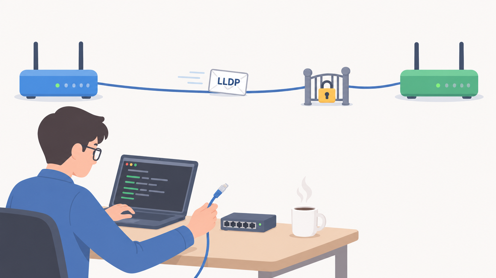

---
authors:
  - sdargoeuves
categories:
  - netlab
date:
  created: 2026-11-01
  # updated: 2026-10-02
draft: false
tags:
  - netlab
  - network
title: "Why are my LLDP neighbors disappearing on Cisco IOL when I enable PIM?"
---

One might ask that very same question, and I would say, it's a good question! Let's deep dive into the why...

<!-- more -->

{ width=600 }

/// caption
<!-- keep empty to center the image, without a caption -->
///

## TL;DR

On Cisco IOL (17.18.02, both `iol` and `ioll2`), enabling PIM on an interface silently stops that interface from **receiving** LLDP frames.

It still sends them, so the neighbor will receive those messages (unless it's also an IOL running PIM on that interface), but no LLDP messages is received on that interface.

The reason: when enabling PIM on an interface, the device enforces a list of accepted MAC addresses, and the LLDP multicast MAC is not on it. IOSv is not affected, and neither are other vendors like cEOS and FRR. It's just the IOL & IOL-L2, as far as I've tested.

## Introduction

For a while, I used a Cisco IOSv vagrant box for all Cisco devices in my lab. But one day, shortly after *netlab* announced the sunsetting of [libvirt provider](https://blog.ipspace.net/2026/09/sunsetting-vagrant-libvirt/), mixed with the drive to reduce the memory usage of my lab (cf. this previous [blog post](../2026-09-lab-memory-usage/index.md)), I decided to investigate other options... Say hi to IOL!

While testing the lab with the IOL and IOL-L2 devices which have now replaced my IOSv, I noticed one weird behaviour: some of my LLDP neighbors were no longer visible, but only on the part of the lab where I play with multicast...

## Lab context

The lab I'm referring contains a few devices (~60 network devices): Cisco, Arista, Juniper, Aruba, Fortigate, Checkpoint, Netscaler, F5 and Extreme.

Because of the mix of vendors, I prefer to use LLDP over CDP, even though I've found out that CDP is supported on at least one non-Cisco vendor! *If you're wondering, it's Arista, I have not investigated other vendors, let me know if others do too.*

The lab is split into several sites, each site will use a mix of different technologies, vendors... that could be a topic for a future blog post, but not now. Let's investigate this funny behaviour.

## Investigations 🕵️

### Pointing fingers

After noticing the LLDP neighbors disappearing only for the site running multicast (PIM), and nowhere else, I had my first clue about what could be causing the issue.

But I was not bothered enough to dive deeper into it just yet. The only thing I could do at that stage was guess that it was multicast related. Then wait patiently...

...

... until Packet Pushers released an [episode on LLDP](https://packetpushers.net/podcasts/n-is-for-networking/n4n063-link-layer-discovery-protocol/)!

This episode confirmed that guess, but also provided a lot more information to better understand how LLDP works. No surprise, it uses multicast!

So now we know that LLDP works fine on IOSv with and without PIM, and I experienced the issue with IOL and IOL-L2 when I enable PIM... Time to reproduce in a mini-lab.

### Reproducing in a small lab

#### Spin the lab up

Here is the netlab topology I used, containing 2x IOL and 2x IOL-L2:

```yaml
provider: clab
defaults:
  device: iol
  devices.iol.clab.image: "vrnetlab/cisco_iol:17.18.02"
  devices.ioll2.clab.image: "vrnetlab/cisco_iol:L2-17.18.02"
nodes:
  r1: {device: iol}
  r2: {device: iol}
  s1: {device: ioll2}
  s2: {device: ioll2}
links: [r1-r2, r2-s2, s2-s1, s1-r1]
```

By default netlab configures LLDP, except on the management interface, so you don't have to do anything: connect to r1 and check the LLDP neighbors:

```cisco
r1#show lldp neighbors
Capability codes:
    (R) Router, (B) Bridge, (T) Telephone, (C) DOCSIS Cable Device
    (W) WLAN Access Point, (P) Repeater, (S) Station, (O) Other

Device ID           Local Intf     Hold-time  Capability      Port ID
r2.lab              Et0/1          120        R               Et0/1
s1.lab              Et0/2          120        B,R             Et0/1

Total entries displayed: 2
```

#### Configure PIM

To keep the test simple, I only enabled PIM on one interface: Ethernet0/1 on r1, towards r2. The link towards s1 (Ethernet0/2) stays untouched, so it can be used as a comparison.

```cisco
r1(config)#interface ethernet0/1
r1(config-if)#ip pim sparse-mode
```

You can of course enable it on more interfaces, by hand or with Ansible, Python, Expect, Perl, Go, or any language of your choice. Or ask your favorite LLM to do this for you.

#### Witness the damage

Existing LLDP entries only disappear once their hold time expires (120s by default). So either wait a bit over 2 minutes, or clear the table and check again after a few seconds. Either way, the neighbors on the PIM interfaces are gone!

```cisco
r1# clear lldp table
r1#sho lldp neighbors 
Capability codes:
    (R) Router, (B) Bridge, (T) Telephone, (C) DOCSIS Cable Device
    (W) WLAN Access Point, (P) Repeater, (S) Station, (O) Other

Device ID           Local Intf     Hold-time  Capability      Port ID
s1.lab              Et0/2          120        B,R             Et0/1

Total entries displayed: 1
```

To see better what's happening, you can use `debug lldp packets` with the `terminal monitor`:

```cisco
r1#debug lldp packets 
LLDP packet info debugging is on
r1#
r1#terminal monitor
r1#   
*Nov  6 01:59:52.908: LLDP advertisement packet TX'd on intf Ethernet0/1
*Nov  6 01:59:57.029: LLDP advertisement packet TX'd on intf Ethernet0/2
*Nov  6 01:59:57.975: LLDP advertisement packet RX'd on intf Ethernet0/2
```

We are receiving the LLDP advertisement packet on one interface, but sending out of both.

### Why is LLDP broken?

To understand what is happening, Claude helped me by analysing the output of the `show controllers` command.

#### What show controllers tells us

On IOL, `show controllers EthernetX/Y` reports `Hardware is AMD Unknown` and prints a software MAC address filter. Two things matter here: the list of MAC addresses the interface is willing to accept, and the `need_af_check` flag, which seems to decide whether that list is actually enforced.

#### Before and after PIM

=== "Without PIM"

    ```cisco hl_lines="21"
    r1#show controllers Ethernet0/2 
    Interface Ethernet0/2
    Hardware is AMD Unknown
    ADDR: 74CED56C9BA0, FASTSEND: 55FEB2FECCF0, MCI_INDEX: 0
    DIST ROUTE ENABLED: 0
    Route Cache Flag: 11
     amdp2_instance=0x74CED56CB798, registers=0x74CED56B7AE8, ib=0x74CED56CBC98
     rx ring entries=32, tx ring entries=64
     rxring=0x74CED56CC000, rxr shadow=0x74CED56CC260, rx_head=3, rx_tail=0
     txring=0x74CED56CC3C0, txr shadow=0x74CED56CC820, tx_head=40, tx_tail=40, tx_count=0
     running=1, port id=0x55FED5AAB3C0
     Software MAC address filter(hash:length/addr/mask/hits):
      0xC0:  0  0180.c200.0002  0000.0000.0000         0
      0xC5:  0  0180.c200.0007  0000.0000.0000         0
     spurious_idon=0, filtered_pak=0, throttled=0, enabled=0, disabled=0
     rx_framing_err=0, rx_overflow_err=0, rx_buffer_err=0
     rx_bpe_err=0, rx_soft_overflow_err=0, rx_no_enp=0, rx_discard=0
     tx_one_col_err=0, tx_more_col_err=0, tx_no_enp=0, tx_deferred_err=0
     tx_underrun_err=0, tx_late_collision_err=0, tx_loss_carrier_err=0
     tx_exc_collision_err=0, tx_buff_err=0, fatal_tx_err=0
     hsrp_conf=0, need_af_check=0, promiscuous mode=off
     tx_limited=0(64)
    ```

=== "With PIM"

    ```cisco hl_lines="26"
    r1#show controllers Ethernet0/1
    Interface Ethernet0/1
    Hardware is AMD Unknown
    ADDR: 74CED56B4720, FASTSEND: 55FEB2FECCF0, MCI_INDEX: 0
    DIST ROUTE ENABLED: 0
    Route Cache Flag: 11
     amdp2_instance=0x74CED56B6318, registers=0x74CED56A2638, ib=0x74CED56B6818
     rx ring entries=32, tx ring entries=64
     rxring=0x74CED56B6B80, rxr shadow=0x74CED56B6DE0, rx_head=20, rx_tail=0
     txring=0x74CED56B6F40, txr shadow=0x74CED56B73A0, tx_head=42, tx_tail=42, tx_count=0
     running=1, port id=0x55FED5AAB310
     Software MAC address filter(hash:length/addr/mask/hits):
      0x00:  0  ffff.ffff.ffff  0000.0000.0000         0
      0x53:  0  0100.5e00.000d  0000.0000.0000         0
      0x76:  0  0100.5e00.0128  0000.0000.0000         0
      0xC0:  0  0180.c200.0002  0000.0000.0000         0
      0xC5:  0  0180.c200.0007  0000.0000.0000         0
      0xDC:  0  aabb.cc00.0110  0000.0000.0000         0
      0x00:  0  0100.5e7f.ffff  0000.007f.ffff         0
     spurious_idon=0, filtered_pak=29, throttled=0, enabled=0, disabled=0
     rx_framing_err=0, rx_overflow_err=0, rx_buffer_err=0
     rx_bpe_err=0, rx_soft_overflow_err=0, rx_no_enp=0, rx_discard=0
     tx_one_col_err=0, tx_more_col_err=0, tx_no_enp=0, tx_deferred_err=0
     tx_underrun_err=0, tx_late_collision_err=0, tx_loss_carrier_err=0
     tx_exc_collision_err=0, tx_buff_err=0, fatal_tx_err=0
     hsrp_conf=0, need_af_check=1, promiscuous mode=off
     tx_limited=0(64)
    ```

**Without PIM, `need_af_check` is 0 and the MAC filter is not applied**: the interface accepts any frame, whatever is in the list. The list doesn't even contain the broadcast or the interface's own MAC and everything works fine.

**With PIM, `need_af_check` becomes 1 and the filter is applied**: only the listed MACs get through, and the LLDP MAC `0180.c200.000e` is not one of them... bye bye LLDP neighbor 👋

#### Why CDP still works

When you enable CDP on the device, it adds the multicast MAC address used by CDP (`0100.0ccc.cccc`, also used by other Cisco protocols such as VTP, DTP, PAgP and UDLD) to the list, so CDP frames still get through when the filter is applied:

```cisco hl_lines="3"
[...]
  0x00:  0  ffff.ffff.ffff  0000.0000.0000         1
  0xC0:  0  0100.0ccc.cccc  0000.0000.0000         9
  0xC0:  1  0180.c200.0002  0000.0000.0000         0
  0xC5:  0  0180.c200.0007  0000.0000.0000         0
  0xDC:  0  aabb.cc00.0110  0000.0000.0000         0
  0x00:  0  0100.5e7f.ffff  0000.007f.ffff         0
[...]
```

#### Reverting

The only way I found to get LLDP working again was to remove PIM from the interface and bounce it (`shutdown` / `no shutdown`). But that's not what I want, as I need PIM enabled. So in my situation, CDP was the way forward to see my L1 neighbors while keeping PIM.

## Is it only affecting IOL?

As far as I've seen, yes. I've tested cEOS, IOSv and FRR, and they work as expected. LLDP stays as it should with or without PIM enabled. It seems to be an IOL-specific *feature* to enable some MAC filtering!

## Side note: what else could be affected?

Continuing the discussion with Claude, we also checked other technologies/protocols which could be affected. PTP could be, as some of its messages use the same destination MAC as LLDP (`0180.c200.000e`). But I was not able to test it: PTP doesn't seem to be supported on IOL despite accepting the commands.

## Conclusion

As I couldn't find a fix, I had to use the workaround, which was to use CDP on those links instead of LLDP, so PIM can be enabled.

But the real conclusion is not this, it's how useful it is to have a lab you can easily use, very flexible, to quickly test something like this LLDP & PIM. You update one line in your topology file, and you can perform the same tests with a different vendor, as LONG AS YOU CAN GET THEIR image... but that's a totally different topic!
